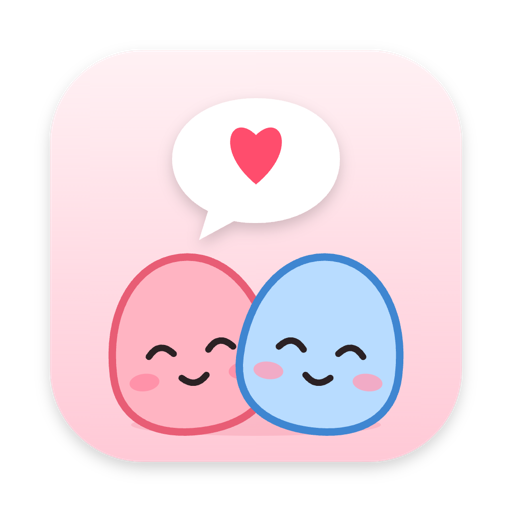

  

<h1 align="center">couple-talk</h1>

둘만 쓰는 작은 데스크톱 메신저와, 바탕화면을 돌아다니는 두 캐릭터

---

서로 다른 곳에서 일하는 두 사람이 가볍게 말을 걸고, 지금 뭐 하는지 보여주고, 하트를 주고받는 앱입니다. 대화는 각자의 PC에서 암호화된 뒤 나가기 때문에 서버 운영자도 내용을 읽을 수 없습니다.

- **종단간 암호화**: 페어링 코드는 서버를 거치지 않고 직접 전달합니다. 서버는 암호문만 중계합니다
- **상태와 액션**: 💻 일하는 중, 🗓️ 회의 중, 🍚 밥 먹는 중 같은 상태와 하트·콕 찌르기·안아주기
- **바탕화면 캐릭터 둘**: 내 캐릭터와 상대 캐릭터가 화면 아래를 걸어 다니며 상태와 액션에 반응합니다
- **캐릭터 팩**: ChatGPT 같은 이미지 생성기로 만든 캐릭터도 규격대로 넣으면 똑같이 움직입니다. 고른 캐릭터는 암호화돼서 상대 화면에도 보입니다
- **직접 띄우는 서버**: 내용을 모르는 작은 중계 서버를 Docker 한 줄로 띄울 수 있고, 서버에 기록을 남기지 않는 모드도 있습니다

## 저장소

| 저장소 | 내용 |
| --- | --- |
| [couple-talk](https://github.com/couple-talk/couple-talk) | 데스크톱 앱(Tauri, Windows·macOS)과 중계 서버(Node, WebSocket, SQLite) |

보안 모델과 막을 수 없는 것은 [README](https://github.com/couple-talk/couple-talk#보안-모델)에, 캐릭터 팩 만드는 법은 [docs/character-pack.md](https://github.com/couple-talk/couple-talk/blob/main/docs/character-pack.md)에, 앞으로의 계획은 [로드맵](https://github.com/couple-talk/couple-talk/issues/13)에 있습니다.

## 만드는 사람

[@seunggulee1007](https://github.com/seunggulee1007) · [@cyeji](https://github.com/cyeji)

코드는 AGPL-3.0입니다. 앱 이름과 캐릭터 이미지는 라이선스와 별개로 저작권자에게 있습니다.
